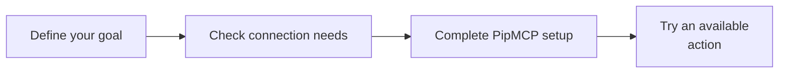

# Plan a clearer handoff from the business to its Danish accounting setup

**Dinero + your AI assistant · powered by PipMCP**

You want a clearer handoff from the business to its Danish accounting setup, but first need to establish what Dinero can support and what is ready in your account.

**Made for:** Bookkeepers

This is a setup helper. You will need PipMCP and access to Dinero to complete a connection.

## Ask your AI to set this up

Paste this into a coding assistant that can open project files and run commands, such as Codex, Claude Code or Grok Build. You do not need to understand the code first.

```text
Help me use this project: https://github.com/jannikco/dinero-mcp

I'm not a programmer. My goal is: Plan a clearer handoff from the business to its Danish
accounting setup.

Read the project instructions and set it up in a new folder without overwriting my work.
Guide me through PipMCP and its private key setup; never ask me to paste secrets into this
chat. Start with the documented setup plan and explain what is still needed to connect my
app. Explain the result in plain English. Ask before changing records, sending messages or
publishing anything.
```

## Three useful things to ask for

```text
Help me plan a clearer handoff from the business to its Danish accounting setup with
Dinero. Explain the setup steps in plain English.
```

```text
Compare that goal with the linked Dinero documentation. Tell me whether an import, account
details or manual setup is still needed.
```

```text
Check which suitable actions are actually available in my PipMCP account. If none are
ready, stop with a missing-step checklist instead of pretending the business task has run.
```

## Your path to a real result



1. [Open the connection guide](https://pipmcp.com/github/start?app=dinero&integration=dinero-mcp&utm_source=github&utm_campaign=github-dinero-mcp&utm_content=people-first-readme) and check whether the app is available or needs an API import.
2. Let your AI explain the required PipMCP account and provider permissions.
3. Run the documented setup check. A successful check is not proof that provider actions ran.

**What to expect:** You get a setup plan and connection checks. This project does not bundle a ready-made Dinero action set. Importing an API or completing manual PipMCP settings may still be needed before any business task can run.

Add your PipMCP key privately in your project settings. Keep keys out of chat and public repositories.

## Keep going

- [Find another useful integration](https://github.com/jannikco/pipmcp-connectors)
- [Connect an API you control](https://github.com/jannikco/openapi-to-mcp)
- [Try the GitHub project](https://github.com/jannikco/github-mcp)

<details>
<summary>Technical reference: installation commands, exact capabilities and troubleshooting</summary>

<!-- people-first:technical:start -->
# Dinero MCP setup and connection checker

**Prepare Dinero for AI workflows with a PipMCP setup doctor, agent instructions and authenticated connector discovery.**

[Activate with PipMCP](https://pipmcp.com/github/start?integration=dinero-mcp&app=dinero&utm_source=github&utm_campaign=github-dinero-mcp) · [Integration directory](https://jannikco.github.io/pipmcp-connectors/integrations/dinero/)

## Build something useful

Prepare Dinero and inspect your hosted setup

This repository is a setup utility. Availability depends on your actual hosted integration and connection.

## Quick start

Requires Node.js 22+. Clone this repository, then:

```sh
npm ci --ignore-scripts
npm test
npm start
# After configuring your provider in PipMCP and setting PIPMCP_API_KEY:
npm start -- --live
# Launch the stdio MCP bridge:
npm run server
```

Create a PipMCP API key with explicit connectors:read and connectors:call scopes. Set PIPMCP_API_KEY in the calling process environment. Provider credentials are configured in PipMCP. Multiple accounts require explicit PIPMCP_INTEGRATION_ID and PIPMCP_CONNECTION_ID from discovery. Existing keys do not gain scopes automatically.

## Built for coding agents

Install this repository's skill into your project:

```sh
node lib/cli.mjs agents install --client codex --scope project --project /path/to/project
# Use claude or grok for those clients.
```

Connect AI agents to Dinero using one PipMCP API key and actual hosted tool discovery. Native AGENTS.md, CLAUDE.md and project skills support the current coding session. No additional AI model key is required. [capabilities.json](capabilities.json) describes the package; [llms.txt](llms.txt) indexes its instructions.

## Inspect actual tools before calling

```js
import {PipMCPGatewayClient} from './lib/index.mjs';
const client = new PipMCPGatewayClient(); // PIPMCP_API_KEY
const inventory = await client.getTools("dinero");
console.log(inventory.data.tools);
// Select a real tool and validate your arguments against its returned schema.
// client.callTool(provider, actualToolName, reviewedArguments, {idempotencyKey});
```

PipMCP enforces workspace, role, connection, policy/approval and usage controls. Preserve the original idempotency key when retrieving/resuming a receipt. Pending and confirmation_required are not completed provider results; uncertain writes are held for reconciliation. The bridge never auto-approves a hosted action.

## Version 1 migration

This release uses the authenticated PipMCP gateway for real discovery/execution. Upgrade your MCP launch command and configure PIPMCP_API_KEY before reconnecting. Historical local runtimes remain available under their original MIT license in Git history. 

## Evidence and support

Transport, package and agent fixtures are tested. Authentication/provider access must be checked in your own configured workspace; synthetic fixtures do not establish live provider execution. Do not include credentials or customer records in public issues. MIT covers this public client.

## Use a manually imported API

If the provider is not already available in your workspace, import your reviewed API definition, publish the selected tools and configure its connection in PipMCP. Set PIPMCP_CONNECTOR_ID=custom-api together with PIPMCP_INTEGRATION_ID and, when needed, PIPMCP_CONNECTION_ID. Then run npm run doctor or npm run server. These select your published private API; they do not change the fixed PipMCP origin or bypass hosted authorization. Leaving PIPMCP_CONNECTOR_ID unset uses dinero. Importing requires integrations:read and integrations:write on the same PipMCP key; discovery and calls use connectors:read and connectors:call.

## Provider setup reference

[Official provider documentation](https://api.dinero.dk/openapi/v1/swagger.json). Credentials are entered in PipMCP; this package does not accept or store provider secrets.

<!-- people-first:technical:end -->

</details>
